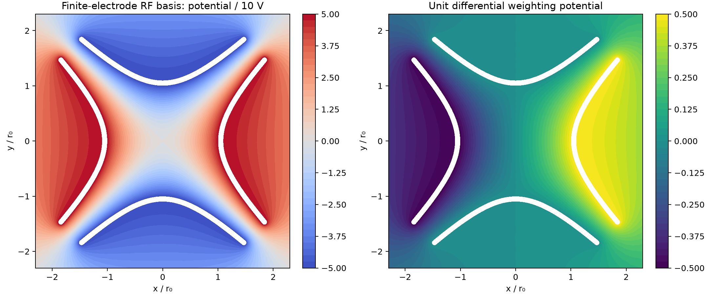
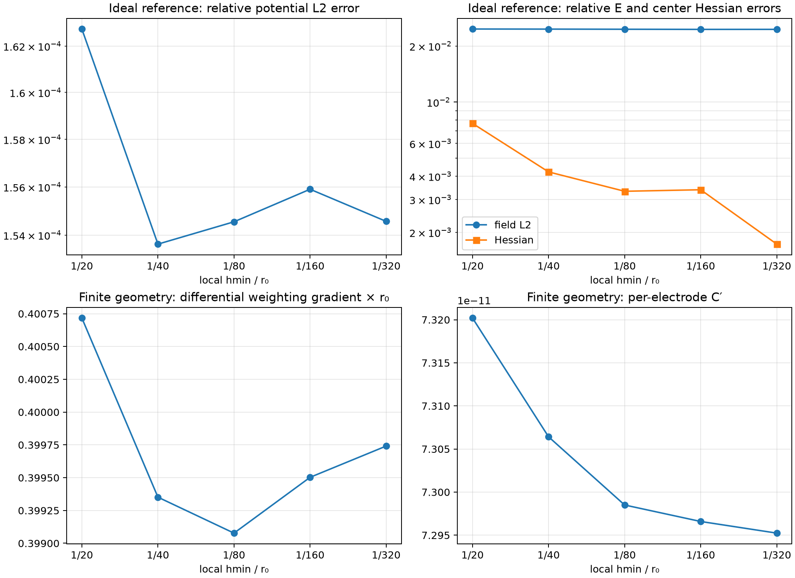

# Stage M2a — bounded study измеримости движения одиночного иона

**Статус:** локальный 2D electrostatic FEM и аналитический lumped-circuit screen завершены. Проверено 5 уровней h-refinement и отдельная чувствительность к аппроксимации границы. Большие sweeps, 3D FEM, стохастические траектории и удалённые вычисления не запускались.

## Краткий результат

Для заданной четырёхветвевой гиперболической геометрии симметричное объединение двух противоположных электродов почти полностью подавляет линейный image-current сигнал около центра. Дифференциальное считывание при сохранении RF drive симметрии устраняет это геометрическое взаимное вычитание в weighting field: вычисленный градиент при 1 V differential составляет 0.39974/r0. Для принятой, но не предсказанной амплитуды движения Ca+ 100 nm в M1-reference ловушке это соответствует току около **7.03 pA peak** на 174.78 MHz.

Это сигналовый масштаб, не доказательство реальной измеримости. Уже в простом входе R || C с 1 pF модуль импеданса составляет примерно 910 Ω на 175 MHz. При иллюстративных 2 nV/√Hz входного voltage noise и 2 fA/√Hz current noise, 300 K, R=1 MΩ и ENBW=1 kHz получается амплитудное отношение сигнал/rms-шум около 0.10. Узкополосный резонатор может улучшить условную чувствительность, но при 100 nm амплитуде расчётное отношение достигает 1 лишь при сочетании малого input capacitance и высокого loaded Q; эти параметры не подтверждены для интегрированного приёмника.

**Рекомендация:** conventional paired RF terminals как единственный motion pickup — **no-go** из-за симметрийного подавления. Дифференциальный съём с пары электродов — **условно перспективный** для следующего readout-моделирования. M2a не подтверждает physical entropy, полезную скорость RNG, полноценную receiver feasibility или конкурентоспособность.

## 1. Геометрия, физические границы и соглашения

Использованы четыре самостоятельных проводящих профиля в XY:

\[
x^2-y^2=+r_0^2 \quad (right,left),\qquad
x^2-y^2=-r_0^2 \quad (top,bottom).
\]

Точная параметризация лицевой поверхности при (r_0=1) в безразмерных координатах:

\[
\mathbf r_R=(\cosh t,\sinh t),\quad
\mathbf r_L=(-\cosh t,\sinh t),\quad
\mathbf r_T=(\sinh t,\cosh t),\quad
\mathbf r_B=(\sinh t,-\cosh t).
\]

Практические полосы имеют толщину 0.1*r0, идут до |x|/r0 или |y|/r0=1.5, а торцы в плоскости XY замкнуты полуокружностями радиуса 0.05*r0. Каждый из четырёх электродов назначается отдельным терминалом. Это один ограниченный дизайн для сравнения; толщина, длина ветвей и termination не оптимизировались. Экструзия по z не моделировалась, поэтому трёхмерные торцевые поля отсутствуют.

Идеальная проверка солвера и физическая задача разделены:

1. **Идеальный benchmark:** прямоугольная область без отверстий; на внешней границе задаётся точный аналитический квадруполь. Это manufactured boundary-value reference для проверки Laplace solver, но не модель конечного устройства.
2. **Конечное устройство:** четыре гиперболических электрода — внутренние границы Лапласовой области; все электроды заданы equipotential. Внешний квадрат на расстоянии 6*r0 заземлён как явный экран. На внешней границе **не** навязывается квадрупольный потенциал. Поэтому отличие поля от идеального решения включает усечение, конечную толщину и влияние grounded enclosure.

Для пары RF-электродов использовались +Vdiff/2 на right/left и -Vdiff/2 на top/bottom. При идеальном пределе:

\[
\Phi=\frac{V_{\rm diff}}{2r_0^2}(x^2-y^2),\qquad
\mathbf E=-\nabla\Phi=\left(-\frac{V_{\rm diff}x}{r_0^2},\frac{V_{\rm diff}y}{r_0^2}\right).
\]

Для идеальной проверки Vdiff=1 V и r0=1; следовательно, точный центрированный Hessian равен (Phi_xx, Phi_xy, Phi_yy)=(1,0,-1) V/r0^2.

## 2. FEM formulation и сходимость

В вакуумной области решалось

\[
\nabla^2\phi=0,
\]

с P1 triangular finite elements. Gmsh задаёт локальное поле размеров элементов около оси и поверхностей электродов; целевые h_min/r0 равны 1/20, 1/40, 1/80, 1/160 и 1/320. Размер вдали от активной области плавно увеличивался. Граница hyperbola/cap представлена плотной кусочно-линейной выборкой CAD-контура; точность её представления отдельно проверена при 50, 100 и 200 точках ветви. Curved P2 элементы не применялись, поэтому данный benchmark не следует считать исследованием поля на микроскопических радиусах шероховатости.

Для веса терминала (k) решалось отдельное уравнение:

\[
\nabla^2\phi_{w,k}=0,\quad \phi_{w,k}=1\text{ на }k,\quad
\phi_{w,k}=0\text{ на остальных электродах и экране},\qquad
\mathbf E_{w,k}=-\nabla\phi_{w,k}.
\]

Согласно теореме Shockley–Ramo, модуль наведённого тока определяется i_k=q*v·Ew,k (знак зависит от направления тока). Для синусоидального смещения x=A*cos(omega*t) вблизи центра:

\[
I_{\rm pk}=|q|\,\omega A\,|\partial_x\phi_w(0)|.
\]

Расчёт (C') из энергии на единицу длины:

\[
C'_{ij}=\epsilon_0\int_{A_{2D}}\nabla\phi_{w,i}\cdot\nabla\phi_{w,j}\,dA,
\qquad C'_{\rm diff}=\tfrac14(C'_{RR}+C'_{LL}-2C'_{RL}),
\]

где C_diff' соответствует +0.5/-0.5 V на паре при 1 V между её терминалами. C' — **ёмкость на единицу длины, F/m**. Умножение на L=10*r0=10 µm ниже является явно заданной straight-electrode приближённой длиной; 2D модель не включает z-end fringing, pads, проводку и front-end input capacitance.

### Численная проверка

| h_min/r0 | Узлы / треугольники | Ideal φ relative L2 | Ideal E relative L2 | Ideal центр Hessian error | Конечный drive q_fit, V/r0² | Differential r0*|grad(phi_w)| | C_electrode', F/m | Higher-multipole fit at 0.4*r0 |
|---:|---:|---:|---:|---:|---:|---:|---:|---:|
| 1/20 | 5 944 / 10 742 | 0.0163% | 2.467% | 0.769% | 10.1138 | 0.400717 | 7.3202e-11 | 1.146% |
| 1/40 | 9 080 / 16 398 | 0.0154% | 2.464% | 0.422% | 10.0739 | 0.399351 | 7.3064e-11 | 0.480% |
| 1/80 | 15 151 / 27 372 | 0.0155% | 2.460% | 0.332% | 10.0628 | 0.399077 | 7.2985e-11 | 0.399% |
| 1/160 | 26 478 / 47 778 | 0.0156% | 2.456% | 0.339% | 10.0918 | 0.399503 | 7.2966e-11 | 0.221% |
| 1/320 | 49 135 / 88 544 | 0.0155% | 2.457% | 0.173% | 10.0810 | 0.399741 | 7.2952e-11 | 0.209% |

**Исправление M2a.1:** первоначальная формула global E-L2 использовала только центроидное значение точного линейного градиента в каждом P1 элементе и не учитывала его внутритреугольную вариацию. Поэтому прежние 1.73% были занижены; корректное интегрирование по моментам элемента даёт 2.46% plateau. Это исправление относится к метрике идеального solver benchmark, а не к weighting-potential solution, finite-electrode gradient или C'. Глобальная ошибка почти не меняется, поскольку h refinement сосредоточен у центра и электродов, а дальняя область остаётся намеренно грубой; это не глобальная равномерная сходимость поля. Центрированная Hessian error снижается до 0.173% при h=r0/320. В конечной геометрии q_fit меняется на 0.107% между последними двумя сетками; differential weighting gradient — на 0.060%; diagonal electrode C' — примерно на 0.0185%. Эти mesh-to-mesh изменения не являются полными error bounds и не заменяют 3D/solver verification.

Полиномиальная аппроксимация высших мультиполей при 0.4*r0 меняется с 0.221% до 0.209% между двумя последними сетками; оцениваемый член мал и чувствителен к области fit и P1-постпроцессингу. Его точность недостаточна для утверждения о точных multipole coefficients. При фиксированном h=r0/160 замена 50 на 200 точек параметризации меняет дифференциальный градиент менее чем на 0.01%, C_diff' — менее чем на 0.03%; boundary faceting здесь не является главным источником ошибки.

Геометрический/солверный скрин не включает диэлектрический oxide, surface charge, finite conductivity, RF skin/current crowding, электрические контакты, нагрев, поле-эмиссию или статистическую шероховатость.

## 3. Парные RF терминалы и differential pickup

В пределе симметрии вклад двух электродов для motion вдоль линии их центров имеет противоположный знак. Для построенной геометрии на самой мелкой сетке:

- градиент weighting potential одиночного правого электрода: 0.399829/r0;
- двух синфазно объединённых right+left электродов: 0.00017568/r0, то есть около 4.39e-4 от одиночного; идеальная часть подавлена симметрией, остаток обусловлен геометрической/численной асимметрией;
- differential-порт с ±0.5 V weighting boundary на паре при 1 V между терминалами: 0.399741/r0.

Следовательно, обычный RF pair, если он непосредственно используется как один измерительный терминал, не является подходящим линейным pickup в симметричном центре. Возможная архитектура — четыре электрически самостоятельных RF ветви, балансный RF feed, высокочастотная развязка/диплексер и differential sense path через тот же электродный pair. Альтернатива — отдельный малый pickup electrode, как применялось в ion-trap mass spectrometry, но он не включён в текущую четырёхэлектродную геометрию и потребует нового geometry benchmark. Разность емкостной наводки и RF phase mismatch необходимо включить в следующую модель.

При тех же 100 nm условной Ca+ амплитуды residual paired-terminal image-current scale составляет около 3.1 fA peak вместо 7.03 pA differential; это симметрийная модельная величина без реального imbalance и CMRR.

В M1 baseline RF drive находится около 2.472 GHz, тогда как secular pickup — около 174.8 MHz. Frequency separation позволяет задать diplexing/band rejection, но численно не ограничивает RF-to-sense coupling: паразитная ёмкостная связь, mismatch и нелинейное насыщение front-end не входят в этот 2D quasistatic solve. Геометрический pair cancellation не является оценкой CMRR реального усилителя.

## 4. Image-current масштаб и lumped receiver

Для Ca+ с f_s=174.784 MHz (принятый M1 результат с axial DC), r0=1 µm и g=|grad(phi_w)|=0.399741/r0:

| Заданная амплитуда A | I_peak |
|---:|---:|
| 1 nm | 0.0703 pA |
| 10 nm | 0.703 pA |
| 100 nm | 7.03 pA |
| 500 nm | 35.2 pA |

Амплитуды заданы для чувствительности; это не вывод из тепловой динамики и не оценка entropy. M1 равновесный классический RMS displacement при 300 K составляет около 227 nm на ось, однако выбранная safe-radius acceptance 0.5*r0 и глубина ∼2.42*kBT делают вывод о тепловом распределении/удержании невалидным без full RF и loss модели.

2D solution даёт C_electrode'=7.2952e-11 F/m и C_diff'=3.7495e-11 F/m. При L=10 µm это примерно 0.730 fF на одиночный электрод и 0.375 fF differential-порта. В пределах предположенного диапазона parasitic C_p=0.1, 1, 10 pF внешняя ёмкость превосходит это 2D значение на сотни–десятки тысяч раз. Реальные C_p, Maxwell capacitance matrix с package и маршрутизация не заданы.

### Резистивный R || C случай

Модель сигнала — Norton current source в параллели с (R) и суммарной ёмкостью:

\[
Z(\omega)=\left(R^{-1}+j\omega C_\Sigma\right)^{-1},\quad
V_s=I_{\rm pk}|Z|,\quad
i_{n,R}=\sqrt{4k_BT/R}\;\mathrm{A}/\sqrt{\mathrm{Hz}}.
\]

Для чисел ниже использованы A=100 nm, C_p=1 pF, R=1 MΩ, 300 K, amplifier e_n=2 nV/√Hz и i_n=2 fA/√Hz. Шумы интегрированы по указанному ENBW при допущении, что Z мало меняется на этом узком полосовом интервале.

| ENBW | |Z(175 MHz)| | Сигнал peak | Выходной шум rms | Отношение signal/noise |
|---:|---:|---:|---:|---:|
| 1 kHz | 910 Ω | 6.40 nV | 63.4 nV | 0.101 |
| 10 kHz | 910 Ω | 6.40 nV | 200 nV | 0.0320 |
| 100 kHz | 910 Ω | 6.40 nV | 634 nV | 0.0101 |

Это не receiver prediction: заданные amplifier noise densities условны, а e_n доминирует в этом примере. При C_p=1 pF, ENBW=1 kHz изменение e_n с 0.5 до 10 nV/√Hz меняет отношение от 0.394 до 0.0202. Без noise density и input network конкретного усилителя численный SNR не идентифицируем. Для сравнения: только Johnson noise резистора без amp noise был бы заметно ниже; поэтому прежняя однорезисторная оценка не характеризовала RF приемник.

### Настроенный parallel RLC сценарий

На резонансе использовано Z≈Rp, Q=Rp*omega0*Csum, L=1/(omega0²*Csum), а ENBW задаёт прямоугольный post-detection passband шириной f0/(2Q), то есть половину tank 3-dB ширины f0/Q. Это не отождествляется с физической шумовой ENBW полного резонатора: тепловой noise integral в ограниченном passband учитывает локальный Lorentzian спад |Z(f)|²; amplifier voltage noise считается белым в выбранной полосе. Параметры не идеально согласованы и без паразитики не рассчитываются: Csum=Cp+C_diff'*L_electrode. Условные результаты для 100 nm:

| (C_p) | (Q) | (R_p) приближённо | Требуемая (L) | ENBW | Амплитудное отношение |
|---:|---:|---:|---:|---:|---:|
| 0.1 pF | 1 000 | 9.0 MΩ | 8.26 µH | 87.4 kHz | 0.578 |
| 0.1 pF | 10 000 | 90 MΩ | 8.26 µH | 8.74 kHz | 5.72 |
| 1 pF | 1 000 | 0.91 MΩ | 0.829 µH | 87.4 kHz | 0.183 |
| 1 pF | 10 000 | 9.1 MΩ | 0.829 µH | 8.74 kHz | 1.83 |
| 10 pF | 1 000 | 91 kΩ | 82.9 nH | 87.4 kHz | 0.0578 |
| 10 pF | 10 000 | 0.91 MΩ | 82.9 nH | 8.74 kHz | 0.579 |

Для C_p=0.1 pF и Q=10^4 отношение выглядит многообещающе, но требует резонатора ∼8 µH и ∼90 MΩ на 175 MHz; это не доказательство компактной on-chip реализации. При 1 pF уже Q=10 000 лишь даёт ratio ∼1.83 при ровно настроенном резонансе. RF pickup, drift, matching loss, phase noise, finite Q and active circuit power в этих числах не моделируются. Это условная чувствительность к принятым параметрам, не обещание детекции.

## 5. Полоса, символы, корреляция и entropy

ENBW — интеграл noise transfer function и характеристика шума приёмника. Она не является универсальным верхним пределом информации: различны ENBW, полезная полоса сигнала, sampling rate, время наблюдения, autocorrelation/innovation rate и bandwidth после conditioning. Для резонатора полоса 3 dB порядка f0/Q, а огибающая затухает за масштаб Q/(pi*f0); oversampling не создаёт независимые символы. Текущая модель не имеет stochastic ion trajectory, квантового измерения, условной min-entropy оценки или оценённой корреляционной функции.

Для Poisson событий с частотой Gamma, в конечном интервале Delta_t:

\[
p_{\rm event}=1-e^{-\Gamma\Delta t},\qquad
H_{\min}^{(1)}=-\log_2\!\left(\max(p_{\rm event},1-p_{\rm event})\right).
\]

При условных Gamma=1000 s^-1 и Delta_t=100 µs (10 ksample/s) получаем p_event=0.09516, H_min=0.1443 bit/bin и IID модельный потолок ∼1.44 kbit/s. Это точный конечный интервал для идеального Poisson event/no-event процесса; фактические события в газе не обязаны быть независимыми, регистрируемыми или без потерь и перерывов. Нельзя приравнивать ENBW к независимой частоте символов или этот пример к entropy rate иона.

## 6. Что M2a установил и не установил

**Установлено в рамках данной геометрии/solver:** FEM проходит manufactured harmonic test; четыре электрода различимы по терминалам; одинаковая пара даёт почти нулевой центральный weighting gradient; нормированный differential-port gradient ∼0.4/r0 устойчив к двум проверенным h/curve-refinements; ёмкостная оценка на единицу длины вычислена через energy bilinear form.

**Не установлено:** измерительный SNR при реальном amplifier; приемлемость RF feedthrough и CMRR; определённая amplitude distribution и ion lifetime; surface-noise PSD; collisions/cooling; физическая conditional entropy или RNG rate; input capacitance/Q настоящей микросхемы; 3D end fringing, axial DC end structures, packaging, resistance/thermal loads.

### Nanoscale applicability и типы ограничений

- Масштабная инвариантность Laplace equation для подобной геометрии — фундаментальный результат **F**, только для классической непрерывной electrostatics и без заданных material lengths.
- h/r0 — численная сеточная точность, а не физический fabrication feature size. При r0=10 nm выбранная толщина 0.1*r0=1 nm уже сопоставима с несколькими атомными слоями; continuum doping/local conductivity/smooth interface assumptions здесь **U/T** и в этой модели не проверены. При r0=100 nm толщина 10 nm допускает continuum electrostatics как начальное приближение, но oxide, roughness, depletion и discrete dopants всё ещё могут быть существенны (**T/U**).
- Конечная толщина, глубина усечения, кривизна/шероховатость, doping/conductivity, pad capacitance и Q — **T**, зависят от процесса и разводки.
- Допустимый SNR, output rate, power и startup overhead — **R**, зависят от системной задачи; universal threshold не задаётся.
- Полеэмиссионная граница, breakdown, локальный silicon surface spectrum и 3D parasitic network — **U**; 2D Laplace FEM их не ограничивает.

Поэтому M2a не назначает универсальную минимальную r0 и не экстраполирует P1 continuum результат как доказательство trapping при 10 nm. Электростатический безразмерный benchmark может быть математически масштабирован, но применимость материала и receiver на этой шкале не установлена.

## 7. Проверки и литературные опоры

Автоматические тесты проверяют четыре гиперболы и симметрии толщины, соглашение потенциала, размерность Shockley–Ramo current scale, RC roll-off/noise, точную Poisson interval probability и один FEM manufactured/weighting-field point. Полный пакет: **17 passed**. Скрипт M2a воспроизводит пять h уровней и curve-sensitivity points локально.

1. W. Shockley, “Currents to Conductors Induced by a Moving Point Charge,” *J. Appl. Phys.* 9, 635 (1938), DOI [10.1063/1.1710367](https://doi.org/10.1063/1.1710367) — weighting-potential theorem.
2. S. Ramo, “Currents Induced by Electron Motion,” *Proc. IRE* 27, 584–585 (1939), DOI [10.1109/JRPROC.1939.228757](https://doi.org/10.1109/JRPROC.1939.228757) — induced-current formulation.
3. M. Soni et al., “Broad-band Fourier transform quadrupole ion trap mass spectrometry,” *Anal. Chem.* 68, 3314 (1996), DOI [10.1021/ac960577s](https://doi.org/10.1021/ac960577s) — trapped-ion image current and differential detector/RF coupling context. This macroscopic mass-spectrometer precedent does not validate the present nanoscale circuit.

## 8. Решение по дальнейшему моделированию

**Условный GO** для следующего ограниченного шага: смоделировать электрически независимые противоположные ветви как differential sensor, добавить выбранную duplex/RF isolation topology, Maxwell capacitance matrix, 3D z-end fringing, receiver input impedance/noise и RF feedthrough/common-mode imbalance. Перед этим надо задать realistic ranges или извлечь из конкретного процессного/топологического набора (C_p, Q, e_n, i_n, CMRR), electrode length and RF-to-sense coupling. Цель — проверить, сохраняется ли сигнал над шумом при допустимом ion amplitude и linewidth, а не искать RNG entropy.

**NO-GO** для вывода об RNG throughput, crypto entropy или полной интегрированной реализуемости на основании этого отчёта. Для автономного RNG отдельно нужны физически обоснованные noise/collision model, cooling and lifetime analysis, loading/restart model и conditional entropy evaluation. Полный 3D FEM и stochastic dynamics ожидают отдельного разрешения.
