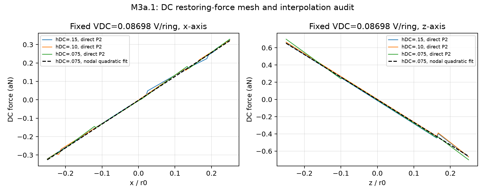

# M3a.1 — аудит силы DC и допуск к длительной динамике

**Статус: NO-GO для расширенных траекторий; расчёты траекторий M3a.1 не запускались.** Это численный блокирующий результат для сохранённого FEM-поля, а не физическое доказательство невозможности ионной ловушки. Главная причина — межсеточное расхождение слабой DC-силы 4–13% в области предполагаемого движения и асимметрия силы на противоположных осевых точках. Полиномиальное поле пока не прошло проверку против исходного P2 поля.

## 1. Аудит M3a и происхождение частоты

Использовались неизменённые входы M3a: `results/m2b2_dc_surface_refined_p2_fields_effective_h0p075.npz` и соответствующий JSON с P2 mesh-конфигурацией. Это finite-length идеальная PEC-модель четырёх отдельных гиперболических RF ветвей длины `10r0`, DC-кольцами при `z=±5.5r0`, пустой вакуумной областью и заземлённым внешним ограждением; границы электродов полигональны. Ионная область и геометрия те же, что в M2b.2/M3a. Не добавлялись свойства реального кремния или диэлектриков.

Координаты FEM — `ξ=r/r0`; RF basis соответствует 1 V дифференциального пикового терминального шаблона, DC basis — 1 V на каждом из двух DC колец. Физические поля вычисляются как `E=−∇Φ`, с градиентом по `ξ`, делённым на `r0`. Опорное напряжение для всего сравнения зафиксировано: `VDC=0.08697882845042744 V` на каждом кольце; RF — 10 V differential peak.

M3a получил это `VDC`, масштабировав FEM `Hzz` самой сетки `hDC=0.075r0` до желаемой локальной частоты 1 MHz. Следовательно, 1 MHz был **задан калибровкой по локальной кривизне**, а не независимо предсказан или наблюдён траекторией. Floquet-частота M3a также использовала эту кривизну. 20 RF cycles = 8.087 ns = `0.0081` axial period; короткая траектория не измеряла осевую моду. Это не ошибка калибровки как таковой, но её нельзя принимать за независимую валидацию поля.

## 2. Сопоставление FEM сеток при фиксированном DC voltage

`scripts/m3a1_dc_force_audit.py` загрузил три сохранённые P2 сетки; геометрия и центральный целевой размер одинаковы (`hcenter=0.18r0`), а менялось только номинальное уточнение поверхности DC-кольца. P2-градиент вычислялся непосредственно в содержащем точку элементе. Поэтому результаты измеряют также элементную негладкость градиента.

| DC surface target | P2 DOF | `Hzz` на 1 V/ring (V/r0²) | `fz` при общем фиксированном `VDC` |
|---:|---:|---:|---:|
| 0.15 r0 | 201,361 | 1.8694796×10⁻⁴ | 997.220 kHz |
| 0.10 r0 | 208,503 | 1.8770387×10⁻⁴ | 999.234 kHz |
| 0.075 r0 | 215,157 | 1.8799164×10⁻⁴ | 1,000.001 kHz |

Близость локальных частот не гарантирует точную силу при конечном смещении: кривизна сглаживает локальную неоднородность, а `VDC` исторически калиброван по самой последней сетке. Например, на оси при `z=+0.10r0` P2 даёт `Fz=−2.619×10⁻¹⁹ N` для `h=.10r0` и `−2.754×10⁻¹⁹ N` для `h=.075r0`; разность продольных компонент, нормированная на fine `|Fz|`, — 4.88%, а полная векторная ошибка — 5.14%. При `z=−0.10r0` силы равны `+2.677×10⁻¹⁹ N` и `+2.400×10⁻¹⁹ N`; соответствующие значения — 11.40% и 12.66%. На fine-сетке модули осевой силы при `z=±0.10r0` различаются примерно на 13.7%, хотя геометрия номинально зеркально симметрична.

В исходном M3a.1 JSON поле `dc_force_difference_over_fine_dc_force` вычислялось как
\[
\delta_{\rm vec}=\frac{\|\mathbf F_c-\mathbf F_f\|}{\|\mathbf F_f\|},
\]
а **не** как изменение модулей сил. Ниже исправлены заголовки и приведены оба показателя. Компоненты `ΔF=F(h=.10)−F(h=.075)` показывают, что различия часто лежат в малых поперечных компонентах.

| Точка | `|FDC|` h=.10 / h=.075 (N) | `ΔF=(ΔFx,ΔFy,ΔFz)` (N) | δ vector | δ magnitude |
|---|---:|---:|---:|---:|
| x=+0.10r0 | 1.332 / 1.340 ×10⁻¹⁹ | (−0.665,−2.871,+5.118)×10⁻²¹ | 4.41% | 0.57% |
| x=−0.10r0 | 1.305 / 1.311 ×10⁻¹⁹ | (+0.855,−9.797,+6.449)×10⁻²¹ | 8.97% | 0.48% |
| y=+0.10r0 | 1.259 / 1.282 ×10⁻¹⁹ | (+2.090,−2.099,+5.501)×10⁻²¹ | 4.87% | 1.79% |
| y=−0.10r0 | 1.288 / 1.307 ×10⁻¹⁹ | (+6.546,+1.653,+4.686)×10⁻²¹ | 6.29% | 1.46% |
| z=+0.10r0 | 2.620 / 2.754 ×10⁻¹⁹ | (+0.326,−4.234,+13.493)×10⁻²¹ | 5.14% | 4.88% |
| z=−0.10r0 | 2.677 / 2.403 ×10⁻¹⁹ | (+10.385,+7.166,+27.675)×10⁻²¹ | 12.66% | 11.40% |
| z=+0.20r0 | 5.013 / 5.438 ×10⁻¹⁹ | (−36.566,+8.009,+43.292)×10⁻²¹ | 10.52% | 7.82% |
| z=−0.20r0 | 5.325 / 5.468 ×10⁻¹⁹ | (+7.140,+14.602,−14.301)×10⁻²¹ | 3.96% | 2.62% |

Поля RF между предыдущими hDC-сетками уже показывали RMS-отличие меньше 0.013% до `0.30r0` (отчёт M3a). На перечисленных точках RF peak-force порядка `10⁻¹³ N`, а DC restoring force порядка `10⁻¹⁹ N`: RF/DC отношение амплитудно велико, но DC всё равно задаёт медленную axial фазу, а малый систематический DC перекос может менять осевое движение за много RF циклов. Поэтому «RF доминирует» не устраняет этот допусковой провал.

## 3. Производные и проверка сглаженного поля

Региональный fit потенциала радиуса `0.5r0` использовал QR/SVD и нормированный полиномиальный базис. Для fine-сетки квадратичная unconstrained модель имела 95 узловых отсчётов, rank 10, condition number 7.55, относительный остаток potential fit 0.776%; след `H` был `1.36×10⁻⁶` в нормированных единицах. Laplace-constrained fit имеет trace ровно ноль по конструкции и потому **не** служит независимой проверкой уравнения Лапласа. Наличие малого остатка потенциала само по себе не гарантирует достаточно точную производную.

| Fine h=.075, локальная модель | число членов | condition | RMS ошибки потенциала на узлах | RMS расхождение градиента с P2 на 256 точках внутри 0.30r0 |
|---|---:|---:|---:|---:|
| Степень 2 | 10 | 7.55 | 0.776% | 5.91% |
| Степень 3 | 20 | 25.78 | 0.718% | 6.50% |
| Степень 4 | 35 | 107.63 | 0.137% | 4.02% |

Степень 4 лучше аппроксимирует nodal potential, но остаётся хуже требуемой для силы и более обусловленно чувствительна. Сглаженное поле пока нельзя использовать для тысяч RF-периодов как «улучшенную истину». Его можно рассматривать только после независимого h-refinement и проверки градиента и сил по траекторному объёму.

Центральные конечные разности потенциала с шагами `0.005–0.02r0` служат ограниченным cross-check: если обе точки лежат в одном P2 тетраэдре, разность может совпасть с элементным градиентом почти точно; если stencil пересекает грань, получено отличие до нескольких процентов (пример `z=−0.1r0`). Это не полностью независимый estimator для кусочно-гладкого FEM-поля. M3a.1 не выдаёт искусственно суженную неопределённость из такого сравнения.

## 4. Оценка стоимости прямого P2 поля

Локальный benchmark `scripts/m3a1_field_cost_benchmark.py` получил примерно `0.000400 s` на DC gradient и `0.000360 s` на RF gradient в одной точке. Для RK4 с 80 шагами на RF период, 2,473 RF периодами на 1 MHz axial period и двумя градиентами на одну правую часть оценка составляет около 602 s (10.0 min) на одну осевую моду; пять периодов — около 3,009 s (50 min) на одну траекторию, без накладных расходов и сохранения данных.

Это оценка стоимости, а не запущенная интеграция. Увеличение длительности сейчас было бы численно неинформативно из-за ошибки силы. Прямой P2 остаётся воспроизводимой базой; ускоренное поле допустимо только после прохождения сравнения по всей целевой области.

## 5. Floquet и статус траекторного gate

M3a local Floquet дал радиальные моды около 176.251 MHz и осевую около 1.0000005 MHz; идеальный `q=0.2` benchmark около 176.253 MHz. Этот результат — локальная линейная периодическая устойчивость на FEM Hessian, а не оценка частоты из длительной траектории. Чувствительность axial mode к слабой DC кривизне здесь ключевая; новая фиксированная DC-сетка проверка показывает диапазон локальной частоты 997.220–1,000.001 kHz, но не охватывает ошибку формы поля или асимметрию за конечным радиусом.

M3a.1 **не запускал** 0.1/1/3/5 axial-period траектории, новую пару интеграторов или timestep convergence. Следовательно, нет новых результатов по axial amplitude, micromotion, work-energy residual, escape или конечновременной confinement. Эти пункты остаются не выполненными, а не отрицательными физическими результатами.

## 6. Решение и минимальный план исправления

**NO-GO для длительной детерминированной динамики и последующих stochastic simulations на текущих полях.** Источник NO-GO — численная неопределённость слабого DC restoring force и непротестированная гладкая редуцированная сила. Это не физический no-go и не основание отвергать четырёхгиперболическую архитектуру.

Перед следующим разрешённым этапом рекомендуется:

1. Удерживать геометрию, terminal tags, `VDC`, `VRF`, RF frequency и RF/end refinement неизменными; независимо уменьшить только центральный размер, например `.18 → .09 → .06r0`, до генерации FEM проверить реальные локальные edge distributions и стоимость P2 DOF.
2. Проверить зеркальную симметрию DC potential/force на `±x, ±y, ±z`; установить причину 13.7% fine-mesh осевой асимметрии (дискретизация сетки, грани элемента, boundary tags или геометрия) и отдельно показать абсолютные force differences.
3. Сопоставлять direct P2 gradient, независимый gradient-recovery estimator и производную гладкого скалярного potential fit на одних и тех же физически фиксированных точках и Sobol-объёме. Улучшать скалярный потенциал, чтобы сохранялось `E=−∇Φ`; не сглаживать компоненты `E` независимо.
4. Принять gate только когда несколько последовательных центральных сеток дают <1% изменения осевой силы в целевой области либо absolute error явно мала относительно рассчитанного stability margin, зеркальные силы согласуются в пределах независимой ошибки, а модели производной согласны.
5. После этого провести короткий direct-P2/reduced-potential benchmark и только затем интегрировать staged окна `0.1`, `1`, `3`, максимум `5` axial periods. Каждый этап — как минимум два интегратора, уменьшение timestep, RF phase checks, работа RF drive и проверка областей поля.

Остаются допущения: PEC, вакуум, полигональные границы, отсутствие реального кремниевого стека и шума. В Stage M3a.1 никакие столкновения, охлаждение, случайные силы, entropy или RNG не вводились.

## 7. Артефакты и воспроизведение

Скрипты: `scripts/m3a1_dc_force_audit.py`, `scripts/m3a1_reduced_dc_field_audit.py`, `scripts/m3a1_field_cost_benchmark.py`, `scripts/plot_m3a1_dc_force_audit.py`; параметры: `configs/m3a1_force_gate.yaml`. Выходы: `results/m3a1_dc_force_audit.json`, `results/m3a1_dc_force_audit.log`, `results/m3a1_reduced_dc_field_audit.json`, `results/m3a1_field_cost_benchmark.json`, `results/figures/m3a1_dc_force_audit.png`. Regression checks: `tests/test_m3a1_audit.py`.

Команда тестов: `..\..\.venv\Scripts\python.exe -m pytest -q --basetemp results/pytest_m3a1` — **31 passed** (включая новые проверки M3a.1). Длительные trajectory scripts для этого этапа не создавались и не запускались; прежние M3a scripts/results оставлены без изменений.
