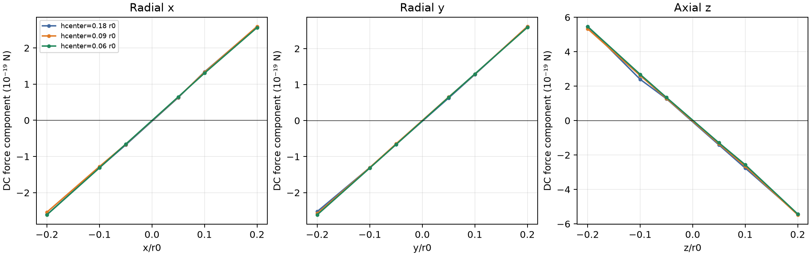
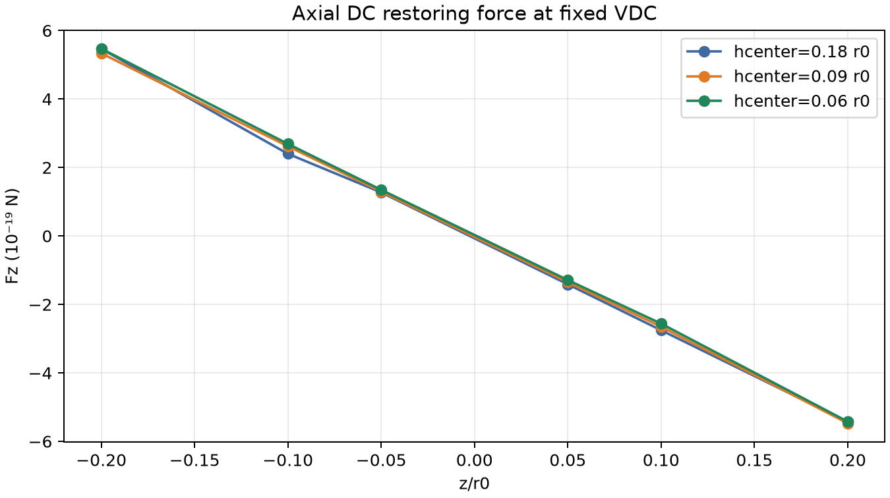

# M3a.2 — сходимость центральной FEM-силы и восстановление симметрии

**Решение: NO-GO для детерминированных траекторий 0.1 и 1 осевого периода на текущих полях.** Уточнение центральной области заметно улучшило симметрию потенциального поля и уменьшило осевую асимметрию силы с ~13.7% на старой сетке до ~4.9% на новой, но прямые P2 силы между двумя последними центральными сетками всё ещё расходятся на несколько процентов; для некоторых компонент и точек полное векторное различие превышает 10%. Это numerical no-go, а не вывод о физической невозможности ловушки. Траектории в этой стадии не запускались.

## 1. Исправление метрик M3a.1

В M3a.1 JSON показатель `dc_force_difference_over_fine_dc_force` был определён как относительная **векторная** ошибка

\[
\delta_{\rm vec}=\frac{\|\mathbf F_c-\mathbf F_f\|}{\|\mathbf F_f\|},
\]

а не как различие модулей. Для отдельного показателя модуля используется

\[
\delta_{\rm mag}=\frac{|\|\mathbf F_c\|-\|\mathbf F_f\||}{\|\mathbf F_f\|}.
\]

Эти метрики отвечают на разные вопросы. Например, при `x=−0.10r0` M3a.1 получил `δvec=8.97%`, но `δmag=0.48%`: модуль радиальной силы почти тот же, однако малая поперечная компонента меняет полный вектор. Таблица M3a.1 теперь имеет исправленные заголовки и показывает `ΔFx,ΔFy,ΔFz`, обе относительные метрики и нормировки. Силы, близкие к нулю, интерпретируются через абсолютную разность, а не относительную ошибку отдельного компонента.

## 2. Геометрия, напряжения и сопоставимость сеток

Сохранена M2b.2/M3a геометрия: четыре самостоятельные конечные гиперболические RF ветви, кольцевые DC электроды при `z=±5.5r0`, пустая вакуумная область и заземлённая симметричная оболочка. Электроды моделируются идеальными проводниками; границы полигональны. Нормировки: RF basis = 1 V differential peak pattern; DC basis = 1 V на каждом кольце. Во всех сетках использовано одно физическое `VDC=0.08697882845042744 V` на кольцо и `VRF=10 V` differential peak; никакой повторной калибровки DC напряжения не выполнялось. Координаты `ξ=r/r0`, поэтому

\[
\mathbf F=-\frac{Q V}{r_0}\nabla_\xi\phi(\boldsymbol\xi).
\]

Для `hcenter=.18r0` mesh-only проба совпала по точкам и тетраэдрам с уже решённой P2 сеткой M2b.2 `hDC=.075r0`; сохранённое поле использовано как базовый результат без повторного solve. Для `.09` и `.06r0` P2 решения выполнены впервые. Не менялись DC surface target `.075r0`, RF surface/end targets `.30r0`, дальнее поле, outer boundary, DC terminal tags или физические параметры.

## 3. Mesh-only verification и ресурсная проверка

Gmsh `Mesh.MeshSizeMin` был установлен как минимум из локально заданных размеров: `.075r0` для `hcenter=.18/.09r0` и `.06r0` для `hcenter=.06r0`. Поэтому floor не подавлял центральные цели. До FEM были сохранены все mesh probes и рассчитаны длины уникальных рёбер из тетраэдров. Gmsh characteristic length не равна максимальному ребру каждого тетраэдра, поэтому проверяются распределения фактических edge lengths, а не только запрос генератору.

| hcenter target | vertices | tetrahedra | estimated P2 DOF | рёбра с midpoint внутри 0.15r0: count / median / p90 (r0) | внутри 0.30r0: count / median / p90 (r0) | центральных тетраэдров, centroid<0.5r0 | central mean-ratio quality: min / median |
|---:|---:|---:|---:|---:|---:|---:|---:|
| .18r0 | 33,526 | 120,509 | 215,157 | 4 / .384 / .476 | 24 / .365 / .492 | 69 | .485 / .871 |
| .09r0 | 33,474 | 120,022 | 214,566 | 13 / .202 / .252 | 88 / .236 / .321 | 187 | .430 / .841 |
| .06r0 | 33,471 | 119,786 | 214,324 | 40 / .146 / .198 | 150 / .199 / .270 | 263 | .457 / .830 |

Центральное уточнение реально и монотонно: около оси median edge length уменьшилась примерно в 2.6 раза от `.18` до `.06r0`; P2 DOF почти не изменились, так как mesher перераспределяет небольшой локальный объём. Цель `.06r0` не означает фактические рёбра `.06r0`: median внутри `0.15r0` равен `.146r0`, p90 — `.198r0`. Это ограничивает силу вывода о достигнутой центральной разрешающей способности. Средний mean-ratio центральных элементов остаётся хорошим; однако глобальный minimum quality для сеток `.09/.06` около `.0063` (тонкие sliver элементы остаются вне центральной области). Это потенциальная обусловленность/поверхностная проблема, не измеренная локальная ошибка центра.

Для новых P2 решений матрица имела около 5.22 млн ненулевых коэффициентов. hcenter=.06: сборка заняла 3.2 s, sparse LU factorization — 112.2 s, шесть правых частей — 1.6 s на локальной машине. Это подтверждает возможность двух ограниченных P2 solve. Память напрямую не логировалась; объем factorization нельзя представлять как измеренный peak RAM. Геометрия и поле hcenter=.09 были успешно решены и сохранены, но постпроцессор сначала завершился на JSON serialization error; P2 NPZ был сохранён и повторно обработан, solve не повторялся.

## 4. Полные векторы сил на совпадающих координатах

В таблице каждая тройка — `(Fx,Fy,Fz)` в единицах `10⁻¹⁹ N`, рассчитана непосредственно из P2 градиента при одном фиксированном физическом напряжении. Последние две колонки сравнивают векторы hcenter `.09` и `.06r0` относительно нормы силы `.06r0`; абсолютные компоненты сил и разностей доступны во всех 22 точках в JSON.

| Точка | F(.18r0) | F(.09r0) | F(.06r0) | δvec .09→.06 | δmag .09→.06 |
|---|---|---|---|---:|---:|
| x=−.20r0 | (−2.606,−.065,−.058) | (−2.538,−.022,−.017) | (−2.611,−.004,+.040) | 3.60% | 2.79% |
| x=−.10r0 | (−1.308,−.020,−.090) | (−1.278,+.004,−.043) | (−1.314,−.009,+.036) | 6.64% | 2.73% |
| x=−.05r0 | (−.680,−.019,−.080) | (−.663,+.017,−.034) | (−.659,−.014,+.028) | 10.55% | 0.60% |
| x=+.05r0 | (+.629,+.003,−.056) | (+.640,+.003,−.036) | (+.647,−.011,+.019) | 8.84% | 1.03% |
| x=+.10r0 | (+1.339,+.034,−.042) | (+1.328,+.021,−.025) | (+1.303,−.013,+.017) | 4.55% | 1.96% |
| x=+.20r0 | (+2.584,+.144,−.080) | (+2.594,+.006,+.020) | (+2.561,−.029,+.012) | 1.92% | 1.27% |
| y=−.20r0 | (−.027,−2.525,−.099) | (−.023,−2.580,+.006) | (−.034,−2.616,+.015) | 1.47% | 1.37% |
| y=−.10r0 | (−.054,−1.304,−.068) | (+.001,−1.304,−.022) | (−.001,−1.317,+.015) | 2.99% | 0.99% |
| y=−.05r0 | (−.053,−.661,−.068) | (+.004,−.646,−.036) | (−.005,−.664,+.024) | 9.60% | 2.72% |
| y=+.05r0 | (−.051,+.626,−.071) | (+.010,+.653,−.031) | (−.002,+.646,+.023) | 8.60% | 1.11% |
| y=+.10r0 | (−.020,+1.280,−.070) | (−.026,+1.290,−.051) | (−.006,+1.296,+.042) | 7.33% | 0.44% |
| y=+.20r0 | (+.020,+2.611,−.002) | (−.035,+2.615,−.001) | (−.015,+2.588,+.081) | 3.42% | 1.02% |
| z=−.20r0 | (−.065,−.077,+5.467) | (+.118,−.125,+5.336) | (−.038,−.059,+5.470) | 3.94% | 2.39% |
| z=−.10r0 | (−.109,−.046,+2.400) | (+.036,+.020,+2.619) | (+.021,−.034,+2.689) | 3.34% | 2.62% |
| z=−.05r0 | (−.062,−.017,+1.273) | (+.027,+.016,+1.296) | (+.006,−.014,+1.347) | 4.71% | 3.79% |
| z=+.05r0 | (−.041,−.019,−1.412) | (+.009,+.007,−1.350) | (−.007,−.017,−1.288) | 5.30% | 4.78% |
| z=+.10r0 | (−.031,−.020,−2.754) | (+.034,−.014,−2.650) | (+.010,−.014,−2.561) | 3.60% | 3.48% |
| z=+.20r0 | (+.029,−.326,−5.428) | (+.086,+.007,−5.471) | (−.020,+.031,−5.423) | 2.20% | 0.89% |

По всему набору из 18 осевых и четырёх off-axis точек max `δvec` для `.09→.06r0` равна 10.55% (x=−.05r0), max `δmag` — 4.78% (z=+.05r0), max absolute vector difference — `2.15×10⁻²⁰ N` (z=−.20r0). Off-axis points с радиусом `.141r0` имеют `δvec=1.55–2.70%`, `δmag=.42–.86%`. Векторные проценты на малых компонентах следует трактовать вместе с абсолютными `ΔF_i`; однако даже продольные компоненты осевой силы меняются на 2.6–3.5% между двумя последними сетками при `z=±.1r0`.

## 5. RF/DC Hessian и restoring-force check

Гессианы получены unconstrained квадратичным fit скалярного nodal potential, SVD-backed функцией M2b `fit_local_hessian`; harmonic constraint не накладывался. Ниже компоненты при fit radius `.35r0`; матрицы, fit condition numbers, остатки и второй radius `.50r0` полностью сохранены в JSON.

| hcenter | RF Hxx | RF Hyy | RF Hzz | RF trace | DC Hxx | DC Hyy | DC Hzz | DC trace |
|---:|---:|---:|---:|---:|---:|---:|---:|---:|
| .18r0 | +.9998703 | −.9998648 | −4.49×10⁻⁶ | +1.05×10⁻⁶ | −9.5071×10⁻⁵ | −9.2296×10⁻⁵ | +1.92108×10⁻⁴ | +4.74×10⁻⁶ |
| .09r0 | +.9998528 | −.9998566 | +3.44×10⁻⁶ | −3.21×10⁻⁷ | −9.3520×10⁻⁵ | −9.3258×10⁻⁵ | +1.89249×10⁻⁴ | +2.47×10⁻⁶ |
| .06r0 | +.9998523 | −.9998510 | −1.45×10⁻⁶ | −2.11×10⁻⁷ | −9.3838×10⁻⁵ | −9.3903×10⁻⁵ | +1.89222×10⁻⁴ | +1.48×10⁻⁶ |

RF кривизна между `.09→.06r0` стабильна: относительные изменения `Hxx≈0.000056%` и `Hyy≈0.00056%`; малый RF `Hzz` сравнивать относительно бессмысленно. При radius `.35r0` DC диагональные изменения `.09→.06r0`: `Hxx 0.34%`, `Hyy 0.69%`, `Hzz −0.014%`. При radius `.50r0` соответствующие изменения `1.40%`, `0.71%`, `0.92%`. Эта fit-radius зависимость и trace residual означают, что Hessian-derived axial frequency не полностью однозначна; для `.06r0` получается около `1.00327 MHz` при radius `.35r0` и `1.00239 MHz` при `.50r0`. Короткая близость к целевым 1 MHz — локальная модель, не trajectory mode.

В проверке восстановления DC-поля из узловой гладкой модели degree-2 в сфере `.30r0` были детерминированно сэмплированы 512 точек. Для hcenter `.06r0` fit градиента `∇φ≈g0+Hξ` дал condition `2.24`, относительный RMS остаток 4.08%, raw trace `−1.04×10⁻⁷`, anti-symmetric Hessian fraction `4.54×10⁻⁴`; симметризованный gradient-recovered Hessian отличается от nodal-potential Hessian на 0.50% по Frobenius норме. Это независимый **постпроцессинговый** estimator того же P2 поля, не независимое PDE решение. Его `Hzz=1.88862×10⁻⁴ V/r0²` близок к nodal fit.

Локальная линейная оценка restoring force использовала `Hzz=1.89222×10⁻⁴ V/r0²` при `.06r0` и `Fz,lin=−Q VDC Hzz ξz/r0`. Прямые P2 `Fz` отклоняются от неё примерно на +2.0% при `z=−.10r0`, +2.9% при `z=+.10r0`, +3.7% при `z=−.20r0` и −2.8% при `z=+.20r0`. Знак restoring force физически верен, величина ещё не mesh-converged на уровне требуемого для длинных фазовых траекторий.

## 6. Зеркальная симметрия и источник остатка

Ожидается `ΦDC(−x,y,z)=ΦDC(x,y,z)` и аналогичная чётность по y и z; градиент преобразуется как вектор отражения: `∇Φ(Sξ)=S∇Φ(ξ)`. В трёх сетках boundary audit нашёл одинаковые числа P2 boundary DOF: каждый из четырёх RF терминалов имеет 22,938 узлов, `dc_plus=dc_minus=5,228`, `ground=8,206`; `missing_boundary_dofs=0`, пересечения терминалов отсутствуют. CAD строится общей трансформируемой hyperbolic profile и одинаковыми annular rings при `±z`, внешний box симметричен. Это делает gross terminal-tag/CAD mismatch маловероятным, хотя полного геометрического CAD-distance proof не проводилось.

| hcenter | max абсолютный residual чётности потенциала (V на 1 V/ring) | max absolute residual parity градиента (V/ξ на 1 V/ring) | RMS относительный parity residual градиента |
|---:|---:|---:|---:|
| .18r0 | 1.90×10⁻⁷ | 2.61×10⁻⁶ | 7.19% |
| .09r0 | 1.09×10⁻⁷ | 1.37×10⁻⁶ | 2.82% |
| .06r0 | 8.33×10⁻⁸ | 9.35×10⁻⁷ | 2.73% |

На `z=±.10r0` в hcenter `.06r0` получены `Fz=+2.6893×10⁻¹⁹ N` и `−2.5609×10⁻¹⁹ N`: различие модулей 4.86% от среднего. Absolute potential parity residual там `4.65×10⁻⁸ V` (0.106% от локального потенциала), а relative vector-gradient parity residual — 4.85%. Уточнение центра уменьшило, но не устранило эту проблему.

В точках `±z=.10r0` выбранные тетраэдры не подходят к координатам вплотную: минимальная дистанция до грани составляет `.00216–.0150r0` для `.06r0` mesh. При сдвигах координаты на `10⁻⁸–10⁻⁴r0` градиент меняется плавно (до ~0.1% при максимальном сдвиге), то есть измеренная асимметрия не похожа на ошибочное попадание точно на элементную грань. Тем не менее P2 градиент разрывен на гранях, а несогласованная unstructured tetrahedral mesh не сохраняет отражение элемент-к-элементу. Наиболее правдоподобное объяснение — сеточная асимметрия плюс восстановление производной из C0 потенциала; это не доказано однозначно, потому что новый независимый solver или симметричная сетка не применялись.

Потенциальный polynomial fit hcenter `.06r0` (`R=.35r0`) имеет condition 8.73 и potential residual 0.159%; его gradient force prediction на 22 тест-точках имеет RMS относительное отличие около 1.60%, maximum 3.35% (z=+.20r0). Для `R=.50r0` RMS около 2.29%, maximum 4.40%. Улучшение относительно M3a.1 существенно, но не валидирует reduced field для длительных траекторий. Harmonic manufactured solution ранее воспроизводился solver-to-postprocessing pipeline с аналитическим Hessian; это сохраняет правильность базового pipeline, но не удостоверяет ошибки конечной CAD/P2 сетки.

## 7. Почему не выполнена conditional dynamics

Условие запуска траектории не выполнено: в intended region `r≤.30r0` сохраняются несколько процентов axial-force magnitude spread и до 10.55% vector-force spread между `.09` и `.06r0`; силовая parity error также выше принятого tolerance. Поэтому не запускались ни 0.1, ни один axial period. Никаких новых данных о двух интеграторах, timestep convergence, work-energy, micromotion, escape или finite-time confinement нет. Аналитическая стабильность Mathieu/Floquet и краткие M3a trajectories остаются прежними историческими результатами и не заменяют этот gate.

## 8. Решение и требуемое продолжение

**NO-GO для расширенной детерминированной динамики и последующего stochastic/entropy modeling.** Центральная h-refinement подтверждает гипотезу, что coarse center mesh был значимой причиной M3a.1 ошибок: potential symmetry улучшилась и axial force asymmetry снизилась с 13.7% до 4.9%. Но force-vector convergence не достигнута; центральные силы в M3a.2 всё ещё зависят от сетки.

Перед возобновлением динамики необходимы: (i) сохранение или введение геометрически отражённой тетраэдрической сетки/явное парное усреднение только после доказательства корректности такого estimator; (ii) дополнительная точечная central refinement так, чтобы edge distributions соответствовали целевому `h`, а не только target parameter; (iii) контроль качества sliver тетраэдров и независимое сравнение P2/аналитически гармонического local reference; (iv) force convergence на фиксированных узлах и по пространственной выборке с <1% или абсолютной ошибкой существенно ниже рассчитанного динамического stability margin; (v) согласие direct P2 gradient, potential polynomial и gradient-recovered estimates. Симметризацию силы постфактум не применять.

Только после отдельного допуска gate допустим один staged trajectory: сначала `0.1 axial period`, затем максимум один период при двух интеграторах и timestep convergence, сравнении direct FEM/reduced-potential и work-energy relation. Никакие stochastic силы или RNG выводы не входят в текущий этап.

## 9. Воспроизведение и артефакты

- Mesh-only: `scripts/m3a2_probe_center_meshes.py`; `results/m3a2_center_mesh_hc0p18.json/.npz`, `...hc0p09.json/.npz`, `...hc0p06.json/.npz`.
- P2 solves: `scripts/m3a2_solve_center_mesh.py`; базовый `.18r0` reuse совпал по `points` и `tetrahedra` побитно с M2b.2; новые поля `results/m3a2_center_fields_hc0p09.npz` и `...hc0p06.{npz,json}`.
- Анализ: `scripts/m3a2_analyze_center_fields.py`; `results/m3a2_center_field_comparison.{json,log}`.
- Фигуры: `scripts/plot_m3a2_center_convergence.py`; `results/figures/m3a2_center_force_convergence.png`, `results/figures/m3a2_axial_symmetry.png`.
- Configuration: `configs/m3a2_center_refinement.yaml`.
- M3a.1 error table correction: `M3A1_EXTENDED_DYNAMICS_VALIDATION_RU.md`.

Все три mesh probes были созданы до FEM; только два новых P2 solve выполнены. Первоначальная попытка solve `.09r0` была остановлена до сборки матрицы, потому что драйвер не включил grounded enclosure в набор fixed boundary DOFs; код исправлен, после чего проверка boundary tags дала zero missing DOFs. Успешный solve h=.09 завершился сохранением field NPZ, но JSON serialization упала на `numpy.int32`; поле восстановлено и проанализировано без повторного solve. Первый analysis run также поймал неверное имя поля у dataclass `HessianFit`; это исправлено до финального comparison. Ошибки драйвера/постпроцессинга не были полевыми результатами; они явно зафиксированы, физические входы и прежние поля не перезаписаны.

Финальная команда regression suite: `..\..\.venv\Scripts\python.exe -m pytest -q --basetemp results/pytest_m3a2` — **33 passed**.
